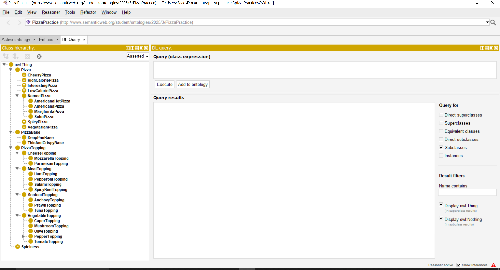

# Semantic Web Labs: OWL Ontology & Apache Jena Fuseki

Lab work for the **Data Engineering for Sustainable and Mobile Applications** course
(IT4SSM Master, UPHF – INSA Hauts-de-France, 2025/2026).

The two labs build on each other: **Lab 2** designs a Pizza ontology in OWL with Protégé,
and **Lab 3** hosts it in a self-hosted triplestore (Apache Jena Fuseki) and queries it with SPARQL,
comparing two reasoners.

**Authors:** Saad Bin Abid, Zahid Shah

| Lab | Topic | Tools | Folder |
|-----|-------|-------|--------|
| 2 | Building an OWL ontology (Pizza domain) | Protégé, OWL 2, DL Query, SPARQL | [`lab2-owl-pizza-ontology`](lab2-owl-pizza-ontology/) |
| 3 | Self-hosted triplestore & reasoning | Apache Jena Fuseki 4.9, Pellet/Openllet, Jena OWL Mini, SPARQL, cURL | [`lab3-fuseki-sparql`](lab3-fuseki-sparql/) |

---

## Lab 2: OWL Pizza Ontology



The ontology (`pizza-ontology.rdf`) models pizzas, bases, toppings and spiciness levels.

- **Classes:** `Pizza`, `PizzaBase`, `PizzaTopping` (Cheese / Meat / Seafood / Vegetable), and `Spiciness` (enumerated: `Hot`, `Medium`, `Mild`)
- **Object properties:** `hasIngredient`, `hasTopping`, `hasBase`, `hasSpiciness`, plus their inverses (`isToppingOf`, `isBaseOf`, …) and `isSpicierThan` / `isMilderThan`
- **Data property:** `hasCaloricContent` (functional, `xsd:integer`)
- **Restrictions:** existential restrictions (every pizza has a base) and closure axioms (e.g. `MargheritaPizza` has only mozzarella and tomato)

### Defined classes (classified by the reasoner)

| Class | Definition |
|-------|------------|
| `CheesyPizza` | `Pizza and (hasTopping some CheeseTopping)` |
| `VegetarianPizza` | `Pizza and (hasTopping only (VegetableTopping or CheeseTopping))` |
| `InterestingPizza` | `Pizza and (hasTopping min 3 PizzaTopping)` |
| `SpicyPizza` | `Pizza and (hasTopping some (hasSpiciness value Hot))` |
| `HighCaloriePizza` | `Pizza and (hasCaloricContent some xsd:integer[>= 400])` |
| `LowCaloriePizza` | `Pizza and (hasCaloricContent some xsd:integer[< 400])` |

The report also includes SPARQL queries that list pizzas by calorie count and toppings by spiciness.

**Open it:** load `pizza-ontology.rdf` in [Protégé](https://protege.stanford.edu/), start a reasoner
(*Reasoner → HermiT/Pellet*), then try the DL Query tab, e.g. `HighCaloriePizza`.

---

## Lab 3: Apache Jena Fuseki & Reasoning

- Deployed **Apache Jena Fuseki 4.9.0** on an Ubuntu VM with two datasets:
  - `pizza-jena`: Jena **OWL Mini** reasoner
  - `pizza-pellet`: **Pellet / Openllet** reasoner
- Loaded the pizza model and data and **compared the two reasoners**. OWL Mini cannot infer
  `SpicyPizza` or `HighCaloriePizza` membership because it lacks numeric datatype restriction support, so
  those queries return 0 results. Pellet classifies them correctly (e.g. avg/min/max calories 721/675/767).
- Queried the SPARQL endpoint over HTTP with **cURL** (JSON results).
- **Extended the ontology:**
  - New data property `hasWeight` (grams)
  - New `Customer` class and `purchasedPizza` object property, with three customer individuals
- Wrote SPARQL queries over the extended model: pizza weights, high-calorie pizzas with weights,
  customer purchases, a customer's pizzas (`OPTIONAL`), and high-calorie pizzas bought by customers.

```sparql
SELECT DISTINCT ?p ?calories ?weight WHERE {
  ?p a pizza:HighCaloriePizza .
  ?p pizza:hasCaloricContent ?calories .
  ?p pizza:hasWeight ?weight .
} ORDER BY DESC(?calories)
```

---

## Repository structure

```
.
├── lab2-owl-pizza-ontology/
│   ├── pizza-ontology.rdf                 # OWL ontology (RDF/XML, open in Protégé)
│   ├── Lab2-OWL-Ontology-Report.docx      # Lab report
│   ├── Lab2-Assignment.pdf                # Lab instructions
│   └── images/protege-class-hierarchy.png
└── lab3-fuseki-sparql/
    ├── Lab3-Fuseki-SPARQL-Report.docx     # Lab report (setup, reasoner comparison, queries)
    └── Lab3-Assignment.pdf                # Lab instructions
```
